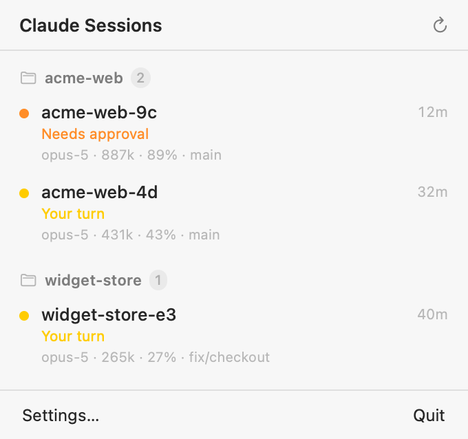

# Crow's Nest

**See which Claude Code session is waiting on you.**

A native macOS **menu bar** app that shows every Claude Code session you have
running — on this Mac and on a remote machine over SSH — most urgent first, so
you can tell at a glance which one is stuck waiting on you. **Then click it:** the
command that reopens that exact conversation in its own folder
(`cd '<dir>' && claude --resume <id>`) is on your clipboard. Paste it into a terminal
on that machine and you're back in the session, with its full history, without
hunting for the window or the session id.

<p align="center">
  <picture>
    <source media="(prefers-color-scheme: dark)" srcset="docs/images/panel-dark.png">
    
  </picture>
</p>

The one thing it exists to tell you: **which session is sitting at an unanswered
permission prompt right now.** When Claude asks "can I run this command?" inside a
window you're not looking at, that session freezes and you have no idea until you
happen to switch to it. Crow's Nest puts that in your menu bar — and when a session
starts needing you, it jumps to the top.

<sub>Built at <a href="https://www.atwavetech.com">Wave Tech</a> and released under MIT.
An independent, community-built tool. Not affiliated with, or endorsed by, Anthropic.</sub>

---

> ### Support posture — read this first
>
> This is a personal tool, built for one setup and published as-is under MIT. It
> reads Claude Code's on-disk files, which are **undocumented** and can change in
> any Claude Code release — when they do, this breaks until someone fixes it.
>
> **I fix what breaks for me.** Issues are open but may go unanswered; PRs are
> welcome but may sit. There is no roadmap and no release cadence. If that's not
> what you need, fork it — that's what the licence is for.
>
> When it does break, it breaks *loudly*: the reason lands in **Settings →
> Diagnostics** and in `~/.crowsnest/last-poll.log`. Please include that in any
> issue. See [SUPPORT.md](SUPPORT.md).

---

## What it shows

Sessions. That's it — most urgent first, each labelled with the git repo it's in.

No machine names, no connection status, no error rows, no "unreachable" warnings.
If the remote machine is off-network the list is simply **empty and calm**.
Anything the app can't reach, or chooses to hide, is explained only in **Settings →
Diagnostics** — never in the session list itself.

Sessions are labelled by **git repo**, not by directory: sessions in `acme-web`,
`acme-web/services/api` and `acme-web/worker` all read `acme-web` rather than
three different names. The session's own name tells subfolder sessions apart.

### The states

| icon | state | meaning |
|---|---|---|
| 🟠 ✋ | **Needs approval** | A tool call was issued and nothing has moved since — an unanswered permission prompt. **This is the state the app is for.** |
| 🟡 💬 | **Your turn** | Claude finished its turn and is waiting for you to type something |
| 🟢 ⚡ | **Working** | A tool call is in flight and the transcript is actively moving |
| ⚪️ 🌙 | **Idle** | A "your turn" session you walked away from — grey, de-emphasised, uncounted |

**Needs approval** sessions come first, then **Your turn**, as full-width cards in
their colour, so the thing that needs you is always the first thing you see. Working
and idle sessions sit below as smaller tiles. The menu bar badge counts only the
sessions that need you now (**Needs approval** + **Your turn**).

## Install

Requires macOS 14+ and the Xcode command line tools (`xcode-select --install`).

```bash
git clone <this-repo> crowsnest
cd crowsnest
./build.sh
open ~/Applications/CrowsNest.app
```

`build.sh` compiles, signs (ad-hoc by default — no Apple account needed), and installs
to `~/Applications/CrowsNest.app`. It's an `LSUIElement` app: menu bar only, no Dock
icon, no app-switcher entry.

**Start at login:** System Settings → General → Login Items → **+** →
`~/Applications/CrowsNest.app`. (Documented rather than done for you, so nothing
adds itself to your login silently.)

**On first launch**, macOS asks to allow Crow's Nest to access devices on your local
network — **click Allow**, or the remote machine can never be reached. See
[docs/troubleshooting.md](docs/troubleshooting.md) if no prompt appears.

## Configure

Open the panel → **Settings**:

- **Machine** — an alias from your `~/.ssh/config` (the same one you already SSH or
  VS Code Remote-SSH with, so its user, port and key are inherited). Leave blank for
  this-Mac-only.
- **Include this Mac** — on by default; turn it off to watch only the remote.
- **Refresh every** — 5s / 15s / 30s / 1m (default 15s).

The remote needs nothing installed: the collector is piped over SSH and is
stdlib-only Python. See [docs/user-guide.md](docs/user-guide.md) for the full setup,
including Windows hosts.

## How it works, briefly

```
CrowsNest.app  ──every 15s──▶  python3 collector.py            (this Mac)
                 ──every 15s──▶  ssh <host> '<py|python3> -' < collector.py   (remote)
                        │
                        └─▶  framed JSON  ──▶  repo groups  ──▶  menu bar
```

`collector.py` reads two things Claude Code writes on each machine — a per-process
registry (`~/.claude/sessions/<pid>.json`) and a per-session transcript
(`~/.claude/projects/<slug>/<sessionId>.jsonl`) — and prints one small JSON document.
It is **piped over SSH stdin**, so nothing is ever installed on the remote and nothing
needs to be kept in sync there.

The full design, and the traps that make it non-trivial, are in
[docs/architecture.md](docs/architecture.md) and [docs/traps.md](docs/traps.md).

## Documentation

- **[User guide](docs/user-guide.md)** — setup, Windows hosts, background agents, what a click and a right-click do
- **[Architecture](docs/architecture.md)** — the collector/app split, state derivation, liveness, the security model
- **[Traps](docs/traps.md)** — the hard-won gotchas: the Store-stub Python, the macOS Local Network deadlock, the SSH control-socket that makes every test lie
- **[Troubleshooting](docs/troubleshooting.md)** — empty list, no prompt, notifications
- **[Contributing](CONTRIBUTING.md)** · **[Support](SUPPORT.md)** · **[Licence (MIT)](LICENSE)**

## Development

Offline preview — rasterises the real panel to a PNG, no screen needed:

```bash
swiftc -O -parse-as-library -DPREVIEW -target arm64-apple-macos14.0 \
    -o /tmp/cnpreview Sources/*.swift && /tmp/cnpreview fixture.json /tmp/panel.png dark
```

Tests:

```bash
python3 -m unittest discover -s tests -t tests   # collector logic
./swift-tests/run.sh                              # notifier + security checks
```

`fixture.json` is a synthetic multi-repo snapshot; the same file drives the app itself
via `CROWSNEST_FIXTURE=/path/to/fixture.json`, bypassing SSH entirely.
