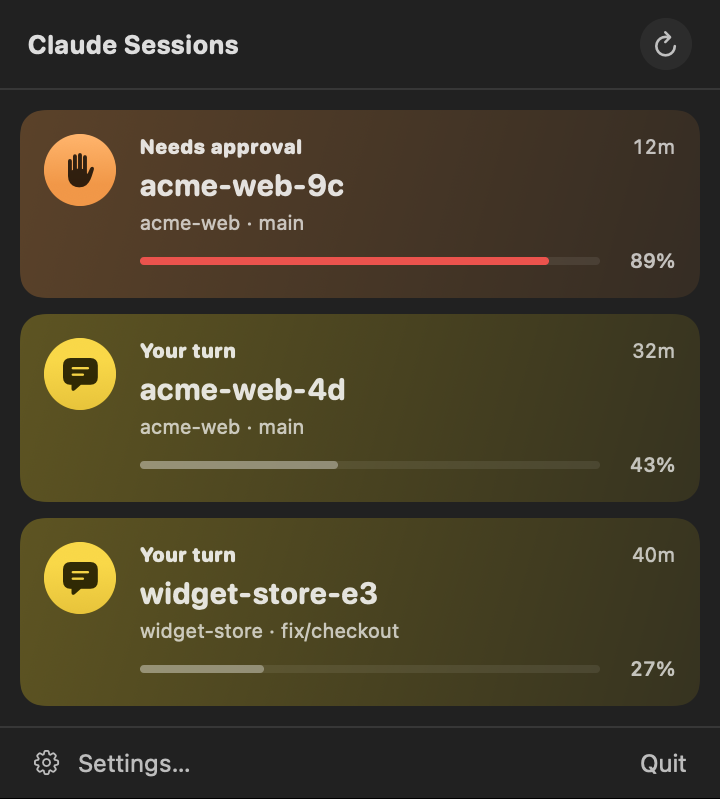

# User guide

## Reading the panel

<p align="center">
  
</p>

Every session is on screen at once, most urgent first. A session that needs you
(**Needs approval**, then **Your turn**) is a full-width card in that state's colour: the
state in words, the session name in large type, its repo and branch, how long since it
last did anything, and a bar showing how full its context window is. Everything else
(**Working**, **Idle**) is a smaller tile, two to a row, with the same facts.

Each state also has its own icon in the disc: a raised hand for approval, a speech bubble
for your turn, a bolt for working, a moon for idle. You can tell the states apart without
relying on colour. The context bar turns red at 85%, when a session is close to needing a
fresh start.

### Click a session

Clicking a card or tile copies its resume command, `cd '<dir>' && claude --resume <id>`,
ready to paste into a terminal. The age briefly reads **✓ Copied** to confirm.

The **menu bar icon** carries a count of the sessions that need you now (**Needs approval**
+ **Your turn**) and its glyph reflects the most urgent state across everything. When
nothing needs you, there's no number.

### Right-click a session

- **Copy Resume Command**: the same as a click. (The path and id are shell-quoted, because
  they come from the remote machine.)
- **Copy Path** — copies the session's working directory.

## Pointing it at a remote machine

Open **Settings** and set **Machine** to an alias from your `~/.ssh/config`. The app uses
the alias, so it inherits whatever you've configured — user, port, key, jump host. Use the
same alias you already SSH or VS Code Remote-SSH with.

Requirements on the remote — all of which a working VS Code Remote-SSH setup already
satisfies:

- **An SSH alias that connects non-interactively.** Test it:
  ```bash
  ssh -o BatchMode=yes <alias> echo ok
  ```
  If that prints `ok`, the app can connect. If it prompts or fails, fix your SSH setup
  first (usually: the host isn't in `known_hosts` yet — just `ssh <alias>` once and accept
  it, or add your key).
- **Any working Python.** The collector is stdlib-only and piped over SSH, so nothing is
  installed on the remote. On Windows, only `py` is real Python (see
  [traps](traps.md#1-on-windows-python-and-python3-are-impostors)) — the app handles that
  automatically by probing and caching the interpreter per host.

Nothing else. No agent to install, no service to run, no copy of the script to keep in
sync — the collector is sent over the wire on every poll.

### Windows hosts specifically

Windows 11 Pro with OpenSSH works. The default shell over SSH is `cmd.exe`, which is fine —
the app invokes the interpreter directly, not through a POSIX shell. Repos on any drive
(`E:\...`, `C:\...`) are handled. The only Windows-specific quirk is the Store-stub Python,
which is why the app never relies on `python3` being real there.

## Background agents

Sessions started with `claude --bg` appear alongside interactive ones. They're tagged
`kind: "bg"` and their name is the task text they were launched with. This is intentional —
a background agent stuck at a permission prompt is exactly as invisible as an interactive
one, so it belongs in the same list.

## Notifications

If you allow notifications on first launch, the app posts one when a session *enters*
**Needs approval** or **Your turn** — only on the transition, never repeatedly while it
sits there, and never a burst when the app starts (the first poll only establishes a
baseline). A session blocked when the app launches won't re-notify; it has to leave and
re-enter the state.

## When something's wrong

By design, the session list never shows errors — an unreachable machine just makes the
list empty and calm. The diagnosis lives in two places:

- **Settings → Diagnostics** — the last poll's session count, anything hidden and why, and
  any transport error.
- `~/.crowsnest/last-poll.log` — the same, on disk.

See [troubleshooting](troubleshooting.md) for the common cases.

## Start at login

System Settings → General → Login Items → **+** → `~/Applications/CrowsNest.app`.

## Uninstall

Quit from the panel, drag `~/Applications/CrowsNest.app` to the Trash, and optionally
remove its state:

```bash
rm -rf ~/.crowsnest ~/Library/Preferences/com.atwavetech.crowsnest.plist
```
